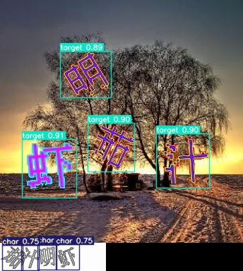
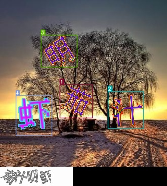
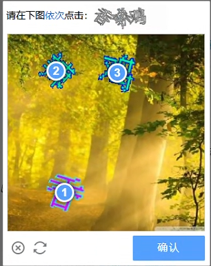
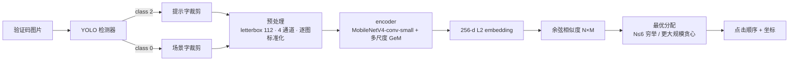
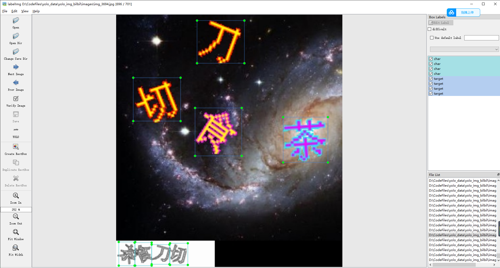
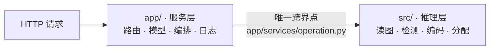
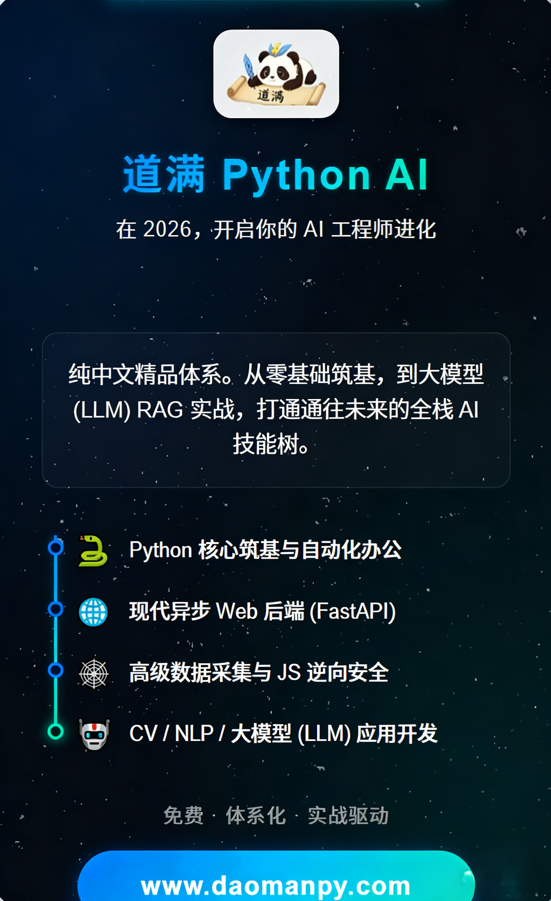

# 点击选择文字验证码识别系统（v8）

一款基于深度学习的文字点选验证码识别方案，专为「文字点选、选字、选择文字」等交互式验证码设计。

> **本次更新是一次推理结构重写**：把早期「Siamese 孪生网络逐对比对」的做法
> 换成 **「提示字 ↔ 场景字」直接匹配 + 全局最优分配**，并把代码分成
> **推理层 `src/`** 与 **Web 层 `app/`** 两条互不依赖的竖线。
>
> 旧实现已从工作区清空：`src/captcha.py`、`src/drawing.py`、`src/utils/*`、v7 的服务端 demo
> 以及 v7 权重 `model/pre_model_v7.onnx` 都已不在当前代码里
> （只在 git 历史的那一版提交里还留着，需要参考可以回看）。
> 文件名 `service_demo.py` 现在给了新的**客户端示例**（见「Web 服务」一节）。
> v7 的设计说明见 [上游仓库](https://github.com/MgArcher/Text_select_captcha)。

## 🤝 合作与反馈

- **开发业务**：验证码识别 / 逆向 / 自动化等定制开发需求，欢迎联系 **yj970814@163.com**
- **项目问题**：请直接提 [Issues](https://github.com/MgArcher/Text_select_captcha/issues)，
  便于追踪与答复（贴上报错信息、Python 版本、复现步骤会更快定位）
- 也欢迎直接提 Pull Request

## 🚀 项目特色

- **不做分类头**：靠字形相似度匹配，新字、生僻字、字体变化都能比，不用为每个字准备类别
- **高速识别**：单张端到端 **60~90 ms**（CPU），其中检测占大头（41~52 ms），编码只占 ~10 ms
- **高精度**：在 `data/eval/geetest_click`（100 张带标注）上严格准确率 **99.0%**
- **模型轻量**：encoder 仅 **7.7 MB**，检测器 9.8 MB，纯 ONNX Runtime，**不需要 PyTorch**
- **职责分层**：推理代码不依赖任何 Web 框架，Web 代码不含任何模型细节
- **开箱即用**：一条命令起服务，并保留旧接口字段，已有调用方零改动

## ✨ 功能亮点

- 文字点选验证码识别（返回按点击顺序排列的坐标）
- RESTful API 服务（`/health`、`/api/v1/schemes`、`/api/v1/identify`、`/api/v1/show`、`/api/v1/upload`）
- 低置信拒识（`margin`）
- 单核 CPU 即可跑，低配机器可部署
- 推理层/服务层物理隔离：`src/` 里 import 不到 FastAPI，`app/` 里看不到 ONNX

## 📸 效果展示


| 原始图片 | 检测结果 | 识别结果（按点击顺序编号） |
| --- | --- | --- |
|  |  |  |

真实页面上的效果（蓝色 `1/2/3` 是模型预测的点击顺序）：



### 支持项目发展

如果您觉得本项目有价值，欢迎通过以下方式支持：

| 微信支付 | 支付宝 |
| --- | --- |
|  |  |

---

## 🔄 本次更新的核心：孪生网络 → 分层双塔

### 两种推理结构的差别

```mermaid
flowchart TB
    subgraph V7["v7 · Siamese 孪生网络（逐对比对）"]
        A1[验证码图] --> B1["YOLO 检测<br/>char=背景文字 / target=待点击文字"]
        B1 --> C1["得到两组图<br/>① 图上要求点的字 ② 场景里的待点字"]
        C1 --> D1["每一个 (要求字, 待点字) 组合<br/>各跑一次孪生网络"]
        D1 --> E1["N×M 个相似度分"]
        E1 --> F1["凑出一一对应<br/>按提示顺序得出点击顺序"]
    end
    subgraph V8["v8 · 分层双塔（先编码，再一次比完）"]
        A2[验证码图] --> B2["YOLO 检测<br/>target=场景字 / char=提示字 / title=提示条"]
        B2 --> C2["encoder 把 N+M 张裁剪图<br/>各编码成 256-d 向量"]
        C2 --> D2["一次矩阵点积 → N×M 余弦"]
        D2 --> E2["全局最优一一分配"]
        E2 --> F2["第 i 个提示字对应的框<br/>就是第 i 个点击点"]
    end
```



**两版做的事其实是同一件**：把「图上要求你点的几个字」和「场景里可点的字」对应起来。
两版都**不识别文字内容、也不查外部字库** —— 没有任何一步知道「这个字念什么」，
只是判断「这两个字形是不是同一个」。改的是**怎么比**：

| 维度 | v7 · Siamese 孪生网络（上游 master） | v8 · 分层双塔（本仓库） |
|---|---|---|
| 比对对象 | 要求点的字 × 场景待点字（同一张图上裁出来的两组图） | 同一件事：提示字 × 场景字 |
| 比对方式 | 每个组合**各跑一次网络**，输出这一对是不是同字 | 每张裁剪图**只编码一次**，得到一个向量 |
| 前向次数 | `N×M` 次（4+4 就是 16 次） | `N+M` 次（4+4 就是 8 次，还能 batch） |
| 顺序怎么得出 | 先拿到 `N×M` 个独立分数，再后处理凑一一对应 | 直接对余弦矩阵做**全局最优一一分配**，同时给出 `margin` |
| 检测类别 | 2 类：`char` 背景文字 / `target` 待点击文字 | 3 类：`target` 场景字 / `char` 提示字 / `title` 提示条 |
| 延迟 | 300~500 ms（上游口径） | 70~90 ms |
| 准确率 | 96%（上游口径） | 99.0%（本仓库 100 张、整图全对口径） |
| 代码结构 | 检测 + 匹配混在一个类里（`src/captcha.py`） | `detector` / `encoder` / `assign` 三层，`pipeline` 串联 |
| 与 Web 的关系 | 识别与 Web 同一层 | `src/` 纯推理，`app/` 纯 Web，单向依赖 |

三条实打实的收益：

1. **前向次数从 `N×M` 降到 `N+M`**：4 个提示字 + 4 个场景字，v7 跑 16 次，v8 跑 8 次编码
   （实测 8 张 112×112 约 8 ms）。字数越多差距越大，4 字题几乎省一半。
2. **比较从「逐对打分」变成「一次矩阵」**：v7 得到的是 `N×M` 个互相独立的分数，
   还得后处理才能凑出合法的一一对应；v8 一次点积得到整张相似度矩阵，
   直接做**全局最优**分配，顺带用 `margin`（top1−top2 均值）给出置信度。
3. **三层可拆、可换**：检测 / 编码 / 分配各自独立，配合下面的推理-Web 分层，
   换检测器不影响编码，换 encoder 不影响分配逻辑。

> `docs/` 里保留了 v7 时代的存档图：`img_1~4.png`（孪生网络样本对等）、
> `myplot1~4.png`（特征匹配效果）、`xiaoxiaole.gif`（消消乐演示）。
> 它们只对应旧实现，与当前 v8 代码无关。

### 三层各自在做什么



**第 1 层 · 检测**（`src/detector.py`）

YOLO 目标检测模型（导出为 end2end ONNX，输出 `[1,300,6]`：`x1,y1,x2,y2,score,cls`）。

- 类别顺序：`0=target`（待点击的场景字）、`1=title`（提示条）、`2=char`（提示字）
  —— v7 只有 `char` / `target` 两类；v8 把**提示字单独成一类**、并加了**提示条**，
  才可能做「提示字 ↔ 场景字」的直接匹配
- 输入 640×640，letterbox（cubic 插值，pad=114），置信度 0.3
- 提示字漏检时用低阈值（0.15）补检一次，数量对得上才采用
- 提示字用「提示条」的位置做过滤，排除画面里其他白底黑字的误检

<div align=center>

<p>YOLO 标注示例</p>
</div>

**第 2 层 · 编码**（`src/encoder.py`）

把每张裁剪图压成 **256 维 L2 归一化向量**：同字不同渲染风格（白底提示字 / 彩色描边场景字）向量接近，不同字远离。

预处理与训练侧逐位一致（`src/encoder.py` 与训练代码同源，改这里等于改模型输入）：

```text
RGB -> letterbox(112, pad=128) -> /255
    -> RGB 逐图逐通道标准化 -> Sobel 第 4 通道 -> CHW float32
```

> 第 4 通道的 Sobel 梯度幅值用来削弱「颜色/背景」这条捷径，强化笔画结构。
> 提示字是白底黑字、场景字是彩色描边，只靠 RGB 容易学到域相关的颜色特征。

**第 3 层 · 分配**（`src/assign.py`）

对 `N×M` 余弦矩阵求**全局最优一一分配**，得到点击顺序：

- `N≤6` 时穷举全部注入（最多 720 种），保证全局最优；
- 更大规模退化贪心，避免阶乘爆炸；
- 顺带给出 `margin`（每个提示字 top1−top2 余弦差的均值），作为低置信拒识信号。

### 模型卡

| 项目 | 值 |
|---|---|
| 骨干 | `mobilenetv4_conv_small`（timm） |
| 输入 | `4 × 112 × 112`（RGB + Sobel） |
| 多尺度特征 | stride 16（96ch）+ stride 32（960ch）→ GeM → 1056 |
| 投影 | 1056 → 512 → 256 → BN → L2 |
| 参数量 | 2.53 M |
| encoder 体积 | 7.37 MB（7.7 MB） |
| 延迟 | 编码 8 张 112×112 ≈ 8 ms / 整图端到端 70~90 ms（CPU） |

---

## 🧱 分层设计：推理层与 Web 层彻底分开

一条边界，三条规则。



| 层 | 目录 | 只负责 | 不该出现 |
|---|---|---|---|
| 推理层 | `src/` | 读图、检测、预处理、embedding、最优分配、结果对象 | `fastapi` `uvicorn` `starlette` `pydantic` |
| 服务层 | `app/` | HTTP 路由、请求/响应模型、业务编排、日志 | `onnxruntime`、ONNX 会话、预处理细节 |

三条规则：

1. 依赖**单向** `app → src`，`src/` 永远不会 import `app/`。
2. `app/` 里只有 `services/operation.py` 碰 `src/`，路由层只调 `operation`。
3. `tests/test_layout.py` 把上面两条钉死：`src/` 一旦 import Web 框架、
   或 `app/` 一旦直接 import `onnxruntime` / `cv2`，测试立刻变红。

这样拆的直接好处：

- 只想要识别能力 → `from src import V8Pipeline`，**不用装 FastAPI**；
- 只想换服务框架（Django / Flask / gRPC / Serverless）→ 只改 `app/`，推理一行不动；
- 两边能分开测：`tests/test_v8_pipeline.py` 不起服务，`tests/test_v8_web.py` 不碰模型内部。

### 目录结构

```text
Text_select_captcha/
├─ src/                        # 【推理层】纯 ONNX Runtime，不依赖 Web 框架
│  ├─ __init__.py              # 对外导出 V8Pipeline / Detection / PlanResult
│  ├─ config.py                # TOML 加载，路径统一相对项目根目录
│  ├─ imageio.py               # 路径 / URL / bytes / base64 / ndarray 统一读图
│  ├─ detector.py              # ① 检测：YOLO + NMS + letterbox/坐标还原
│  ├─ encoder.py               # ② 编码：4 通道预处理 + ONNX encoder
│  ├─ assign.py                # ③ 分配：N×M 最优一一分配
│  ├─ pipeline.py              # 串联三层 + PlanResult
│  └─ draw.py                  # 结果可视化
├─ app/                        # 【服务层】HTTP 协议 / 路由 / 模型 / 编排 / 日志
│  ├─ main.py                  # 应用工厂 + /health + 统一异常 + 模块级 app
│  ├─ middleware.py            # 访问日志中间件（纯 ASGI）
│  ├─ api/
│  │  ├─ router.py             # v1 路由聚合
│  │  └─ endpoints/{dianxuan,schemes}.py
│  ├─ models/{input,output}.py # 请求模型 / 响应契约
│  ├─ services/operation.py    # 模型单例 + 取图/推理/画图编排（唯一接触 src 的地方）
│  └─ utils/{errors,log}.py    # 业务异常 + 日志
├─ configs/v8.toml             # 检测器 / encoder / 方案 / 服务 / 日志参数
├─ model/                      # v8 权重（已入库，共 ~17.5 MB）
├─ service.py                  # 启动入口（argparse + uvicorn）
├─ demo.py                     # 命令行体验（本地直接跑推理）
├─ service_demo.py             # 客户端示例：图片 -> base64 -> 调服务拿 JSON
├─ bilbil.py                   # B 站登录 + 极验点选（playwright）示例
├─ docs/                       # README 图片
└─ requirements.txt

# 以下为本地辅助目录，.gitignore 已排除、不入库
├─ tests/                      # pytest（分层约束 / 管线 / 接口 / 日志）
└─ tools/                      # e2e_check.py（真起服务自检）、eval_geetest.py（评测）
```

---

## 📋 快速开始

### 环境配置

```bash
git clone https://github.com/MgArcher/Text_select_captcha.git
cd Text_select_captcha

pip install -r requirements.txt
```

要求 Python 3.9+；推理只需 ONNX Runtime，**不需要 PyTorch / CUDA**。

### 准备模型

**权重已随仓库提供，克隆下来就能跑**，无需额外下载：

```text
model/
├─ best_v3.onnx      9.8 MB   YOLO 检测器（类顺序 target,title,char）
└─ v8_encoder.onnx   7.7 MB   [B,4,112,112] -> [B,256]（已 L2 归一化）
```

> v7 的孪生网络权重 `pre_model_v7.onnx` 已从仓库移除，v8 也不需要它；
> 只有翻到 git 历史里的旧提交才能看到。

### 命令行快速体验

```bash
python demo.py
```

```text
文字坐标（点击顺序）：[[128, 175, 191, 242], [224, 193, 297, 267], [85, 71, 158, 137], [32, 197, 106, 274]]
耗时：77ms  margin=0.4412
```

```bash
python demo.py --image docs/res.jpg --show out.jpg   # 保存标注图
python demo.py --detect                              # 只看检测框（排查漏检）
python demo.py --json                                # 只输出 JSON
```

---

## 🐍 只用推理层（不需要 FastAPI）

```python
from src import V8Pipeline

pipe = V8Pipeline()                    # 默认读 configs/v8.toml

plan = pipe.predict("docs/res.jpg")    # 路径 / bytes / base64 / ndarray / PIL 都支持
print(plan.boxes)      # [[x1,y1,x2,y2], ...] 按点击顺序
print(plan.points)     # 点击中心点
print(plan.scores)     # 每个字的匹配余弦
print(plan.margin)     # 低置信拒识依据（top1-top2 差的均值）
print(plan.to_dict())  # 完整结果（含 timings_ms）

# 只做检测（不开识别，排查漏检用）
pipe.detection("docs/res.jpg")   # -> [[x1,y1,x2,y2,score,cls], ...]
```

> v7 的 `TextSelectCaptcha().run() / run_dict()` **已移除**，对应写法是
> `V8Pipeline().predict()`，读 `plan.boxes` / `plan.to_dict()`；
> 旧字段 `imgW/imgH/point/corp` 只在 HTTP `/api/v1/identify` 的 `res` 里由服务层拼出来。
> 走 HTTP 的老调用方零改动。

三个计时口径都在 `timings_ms` 里：`decode` / `detect` / `preprocess` / `encode` / `assign` / `total`。

### 低置信拒识

`margin` 是每个提示字 top1−top2 余弦差的均值，建议业务侧加阈值：

```python
if plan.margin < 0.15 or plan.error:
    print("低置信，转人工/重试")
```

---

## 🌐 Web 服务

```bash
python service.py            # 默认读 configs/v8.toml 的 [server]（0.0.0.0:8000）
```

等价写法：

```bash
uvicorn app.main:app                    # 模块级 app 对象，默认懒加载
uvicorn app.main:create_app --factory   # 工厂模式
uvicorn app.main:app --reload           # 开发热重载
```

启动后访问 `http://127.0.0.1:8000/docs` 看交互式文档：

```bash
python service.py --port 8002 --eager    # 换端口 / 启动即加载模型
```

### 接口

| 方法 | 路径 | 说明 |
|---|---|---|
| GET | `/health` | 健康检查，返回 encoder 规格、`embed_dim`、类别表 |
| GET | `/api/v1/schemes` | 已加载方案列表 |
| POST | `/api/v1/identify` | 识别：**新旧字段合并在同一个 data 里** |
| POST | `/api/v1/show` | 标注后的 JPEG（图片来源：URL / base64） |
| POST | `/api/v1/upload` | 标注后的 JPEG（图片来源：**multipart 上传文件**） |

`/show` 与 `/upload` 输出**完全一致**（同一条渲染路径，实测逐字节相同），区别只是图片来源。

### 请求

```json
{"dataType": 2, "imageSource": "<base64>", "imageID": "optional"}
```

- `dataType=1`：`imageSource` 是 URL
- `dataType=2`：base64（可带 `data:image/jpeg;base64,` 前缀）
- `imageID`：**可选**。传了原样回传；不传则由服务端生成（直接复用本次请求号），
  所以响应里的 `imageID` 永远非空，可以放心当对账键

> `inputChars`（提示文字）**已删除**：要点的字是从图上检测出来的，
> 传一句「请依次点击：天 地 人」既不参与推理、也保证不了和图上一致。
> 老调用方多传这个字段不会报错（pydantic 忽略未知字段）。

```bash
curl -X POST http://127.0.0.1:8000/api/v1/identify \
  -H "Content-Type: application/json" \
  -d '{"dataType": 2, "imageSource": "<base64>"}'
```

### 响应

```json
{
  "code": 200,
  "msg": "成功",
  "data": {
    "imageID": "demo-001",
    "scheme": "geetest_click",

    "res": {
      "imgW": 344,
      "imgH": 384,
      "point": [{"x_rel": 159.5, "y_rel": 208.5}, "..."],
      "corp": [{"x1": 128, "y1": 175, "x2": 191, "y2": 242}, "..."]
    },

    "boxes": [[128,175,191,242], [224,193,297,267], [85,71,158,137], [32,197,106,274]],
    "points": [[159.5,208.5], [260.5,230.0], [121.5,104.0], [69.0,235.5]],
    "scores": [0.8069, 0.8886, 0.9401, 0.7006],
    "order": [0, 1, 2, 3],
    "margin": 0.4412,
    "n_prompts": 4,
    "n_targets": 4,
    "timings_ms": {"decode": 1.0, "detect": 48.4, "preprocess": 11.6, "encode": 8.0, "assign": 0.2, "total": 73.6},
    "error": null
  }
}
```

`res` 与 `boxes` 来自**同一次推理**，`res.corp` 就是 `boxes` 换个形状，不会有第二遍计算。
老代码读 `data.res.corp`，新代码读 `data.boxes`，互不影响。

> **注意：** 返回的坐标顺序即为文字需要点击的顺序。

### 上传文件直接看效果

```bash
curl -X POST http://127.0.0.1:8000/api/v1/upload -F "file=@docs/res.jpg" -o out.jpg
```

- 返回 `image/jpeg`，内容与 `/api/v1/show` **逐字节一致**（框 + 点击序号）
- 响应头 `X-Code`：`200` 正常，`500` 识别失败（此时返回原图）
- 响应头 `X-Filename`：原样回传文件名
- 响应头 `X-Image-ID`：本次结果 id；想指定就一起传表单字段 `imageID`
- 空文件 / 非图片 / 超限 → `{"code":400,...}`
- 也可以在 `/docs` 里点 `/upload` 的 *Try it out* 直接选文件

### 客户端示例（`service_demo.py`）

不想自己拼 base64，就用现成脚本（只依赖标准库，不需要 `requests`）：

```bash
python service.py --eager              # 另开一个终端起服务
python service_demo.py                 # 默认上传 docs/res.jpg
python service_demo.py --image out.jpg --service http://127.0.0.1:8002
python service_demo.py --url https://example.com/a.jpg   # 交给服务端下载（dataType=1）
python service_demo.py --raw           # 只打服务返回的原始 JSON
```

输出：

```text
[请求] res.jpg  73567 B  ->  base64 98092 字符

[响应] code=200  msg=成功
  imageID    : 106501c9
  scheme     : geetest_click
  点击顺序框 : [[128, 175, 191, 242], [224, 193, 297, 267], [85, 71, 158, 137], [32, 197, 106, 274]]
  点击中心点 : [[159.5, 208.5], [260.5, 230.0], [121.5, 104.0], [69.0, 235.5]]
  scores     : [0.8069, 0.8886, 0.9401, 0.7006]
  margin     : 0.4412   (低置信拒识参考，<0.15 建议重试)
  检测数量   : prompts=4 targets=4
  耗时(ms)   : {'decode': 5.92, 'detect': 55.92, 'encode': 11.71, 'total': 87.59}
  旧字段 res : imgW=344 imgH=384 corp 4 个
```

退出码：`0` 成功 / `1` 服务返回业务错误 / `2` 连不上或参数问题（方便放进脚本里判断）。

### 错误约定

**HTTP 恒为 200**，业务码在 body（`400` 参数/解码失败、`500` 识别失败）。
pydantic 默认的 422 也会被统一压成 `200 + code 400`，调用方只看 `body.code` 一处即可。

模型**懒加载**：默认首个请求才加载。加载前 `/health` 的 `status` 仍是 `ok`，
但 `loaded` 为空、没有 `spec`；只有加载失败才变 `degraded`，原因在 `errors` 里（不会让服务起不来）。
需要预热就用 `--eager`。

---


## 🤖 B 站登录示例（`bilbil.py`）

`bilbil.py` 是 playwright 同步 API 写的 B 站登录脚本，含极验**文字点选**自动处理，
可以当作「把识别结果真正用起来」的参考实现。

```bash
pip install playwright
python -m playwright install chromium

python bilbil.py                          # 有头模式，便于观察点击
python bilbil.py --headless               # 无头模式
python bilbil.py -u <账号> -p <密码> --retries 3
```

### 退出码（想单独验证识别是否准确，就用它）

| 退出码 | 含义 |
|---|---|
| `0` | 登录成功 |
| `2` | **验证码识别通过**，但账号/密码不对（平台提示「密码错误」等） |
| `1` | 其他失败（表单没找到 / 验证码没过 / 超时） |

> 只想验证识别准确率时，故意传一个错误账号密码即可：只要返回 `2`，
> 就说明**验证码是点对了的**。


## ⚙️ 配置

`configs/v8.toml`：

| 段 | 字段 | 默认 | 说明 |
|---|---|---|---|
| `[detector]` | `model` | `model/best_v3.onnx` | 检测器权重 |
| | `classes` | `[target, title, char]` | 类别顺序 |
| | `conf` / `iou` | 0.3 / 0.5 | 检测阈值 |
| | `input_size` | 640 | 检测输入尺寸 |
| | `pad` / `interp` | 114 / cubic | letterbox 填充与插值 |
| `[encoder]` | `model` | `model/v8_encoder.onnx` | embedding 模型 |
| | `input_size` | 112 | letterbox 尺寸 |
| | `channels` | 4 | RGB + Sobel |
| | `standardize` | `per_image_channel` | 逐图逐通道标准化 |
| | `max_batch` | 32 | 编码分块大小 |
| `[scheme]` | `target_cls` / `title_cls` / `prompt_cls` | 0 / 1 / 2 | 类别映射 |
| | `crop_pad` | 1 | 裁剪外扩像素 |
| | `adaptive_conf` / `fallback_conf` | true / 0.15 | 提示字漏检时低阈值补检 |
| `[server]` | `host` / `port` | `0.0.0.0` / 8000 | 服务地址（只被 `app/` 读取） |
| | `max_image_mb` | 5 | 图片大小上限 |
| `[log]` | `dir` / `level` | `logs` / `INFO` | 日志目录与级别 |
| | `max_mb` / `backups` | 10 / 5 | 滚动策略 |

> `[server]` 与 `[log]` 属于服务层配置，`src/` 不会读它们 —— 这也是分层的一部分。

---

## 🧪 测试

```bash
pip install pytest httpx
pytest -q
```

| 文件 | 覆盖 |
|---|---|
| `tests/test_v8_pipeline.py` | 分配器正确性、预处理形状/通道、端到端识别、v7 兼容已移除 |
| `tests/test_v8_web.py` | 全部 HTTP 接口、坏 base64、缺字段、JPEG 输出、`imageID` 规则 |
| `tests/test_layout.py` | 分层约束：`src/` 不 import Web 框架、`app/` 不直接 import onnxruntime/cv2、HTTP 恒 200 |
| `tests/test_logging.py` | 访问日志落盘、图片不落日志、`X-Request-ID`、滚动 handler |


```bash
python tools/e2e_check.py
```

---

## 📊 准确率评测

在 `data/eval/geetest_click`（`jiyan.json` 100 张带标注图片）上评测：

```bash
python tools/eval_geetest.py --breakdown
```

| 点选字数 | 正确/总数 | 准确率 |
|---|---|---|
| 2 字 | 35/35 | **100%** |
| 3 字 | 37/37 | **100%** |
| 4 字 | 27/28 | 96.4% |
| **合计** | **99/100** | **99.0%** |

- 口径：`jiyan.json` 的 `order` 是「按 x 排序的名次」置换，整图顺序全对才算对；
- 唯一失败是 `2.png` 的**顺序错**（相邻字序颠倒），没有检测失败或字数不符；
- p50 **~51 ms** / mean ~54 ms（CPU）；
- 用 `Text_select_captcha_bendi/tools/eval_scheme.py --scheme geetest_click` 跑同一套数据结果逐张一致，
  说明两套实现等价。

---

## 🏋️ 关于训练

训练代码（PyTorch + timm）在 `captcha_next/`：

```bash
python train/train_v8.py --config configs/v8.toml
python train/export_onnx.py --checkpoint weights/best.pth
```

训练数据按「一张验证码一个 folder」组织，`char_i` 与 `plan_i` 是同一个字：

```text
data/vercode1117/<source>/<folder>/
├─ char_1.jpg     # 提示字（白底黑字）
├─ plan_1.jpg     # 场景字（照片底彩色字）
├─ char_2.jpg
└─ plan_2.jpg
```

验证集按 folder 划分，避免同图泄漏。检测器如需自训，保持类别 `0=target, 1=title, 2=char` 即可。

---

## 📈 更新历史

### 2026.11.04 · 推理结构重写 + 分层

**推理结构（本次主要改动）**

- **Siamese 逐对比对 → 先编码再一次性比较**：v7 的实现文件已不在了
  （`src/captcha.py`、`src/drawing.py`、`src/utils/{matchingMode,ver_onnx,yolo_onnx}.py`、
  v7 的服务端 demo、权重 `model/pre_model_v7.onnx`，只存在于 git 历史）；
  其中 `service_demo.py` 这个文件名被复用成了新的客户端示例（图片 → base64 → 调服务拿 JSON）；
  现在是 `detector`（检测）/ `encoder`（编码）/ `assign`（分配）三层，由 `pipeline` 串联。
  比对的两组图还是同一组（图上要求点的字 × 场景待点字），变的只是**怎么比**：
  v7 每个组合各跑一次网络（`N×M` 次），v8 每张裁剪图只编码一次（`N+M` 次，可 batch），
  再对整张余弦矩阵做全局最优一一分配
- **检测从 2 类细化到 3 类**：v7 只有 `char`（背景文字）/ `target`（待点文字），
  提示字混在背景文字里；v8 把**提示字单独成 `char` 类**、并新增 `title`（提示条），
  用提示条的位置稳定圈定提示字，排除画面里其他白底黑字的误检
- **匹配方式改为开放集向量比较**：`256-d` L2 embedding + 余弦矩阵 + 全局最优一一分配，
  不再逐对跑网络；`margin`（top1−top2 均值）作为低置信拒识信号
- **预处理与训练严格对齐**：4 通道（RGB + Sobel）、`letterbox(112, pad=128)`、
  逐图逐通道标准化，全部收进 `src/encoder.py` 并注明「改这里等于改模型输入」
- **关闭 v7 兼容**：删掉 `V8Pipeline.run()` / `run_dict()` 与 `PlanResult.to_legacy_dict()`，
  推理层不再保留任何旧字段名；旧字段改由服务层 `_legacy_res()` 拼出
- **`src/` 收敛到 8 个文件**（原 11 个）：`preprocess.py` 并进 `encoder.py`、
  `letterbox.py` 并进 `detector.py`、`types.py` 拆分到产物所在文件、
  `assign.py` 用一次 `permutations` 取代三套穷举分支；
  同时删掉无人调用的 `predict_pairs` / `Pipeline.annotate` / `batch_tensors` / `V8PairHead`
- 精简后评测仍是 **99/100**，连错的都是同一张 `2.png`、同一个错误顺序（结构改了、结果没变）

- 权重入库：`model/best_v3.onnx`（9.8 MB）+ `model/v8_encoder.onnx`（7.7 MB）随仓库分发，
  克隆即可运行；`.gitignore` 里原来的 `model/*.onnx` 规则已移除，v7 权重 `pre_model_v7.onnx` 同时删除

**分层（推理 / Web 分离）**

- `src/v8/` 摊平为 `src/`，成为纯推理层；`app/` 恢复为 Web 服务层并接到 v8
- 依赖方向固定 `app → src`，被 `tests/test_layout.py` 钉住
- 模型改**懒加载**：`app/__init__.py` 不再在 import 时建模型，首个请求加载或 `--eager` 预热
- 统一错误契约：HTTP 恒 200、业务码在 body；pydantic 422 压成 `200 + 400`
- `config.py` 的 `ROOT` 修正为 `parents[1]`（原来指向项目上一级，配置/权重会解析错位）

**服务层配套改动**

- 接口 4 → 2：`/identify` 一次给全新旧字段，`/show` 保留；新增 `POST /api/v1/upload`（直传文件回标注图）
- 请求模型删除 `inputChars`（提示字由检测器从图上读，字符串从来不参与推理，留着只会误导调用方）
- `imageID` 改为可选：不传则复用本次请求号，`/show` `/upload` 用 `X-Image-ID` 回传
- 新增访问日志中间件（纯 ASGI，读完 body 再回放）+ 滚动文件日志，图片内容永不落盘
- `bilbil.py` 按真实页面重写（语义选择器 / wrap 坐标基准 / 结果判定去旧文案），692 → 244 行
- 修 `tools/e2e_check.py` 用 `subprocess.PIPE` 起服务却从不读管道导致的死锁（Windows 管道仅 4KB）

### 之前的版本


- **2026.04.29**：代码重构，提升识别效果与泛化能力，优化推理速度，简化部署流程
- **2024.09.12**：升级孪生网络模型，新增基于 `pyppeteer` 的自动化操作支持
- **2024.08.17**：修复 `bilbil.py` 兼容性问题，修正点击位置偏移
- **2023.11.12**：优化识别准确率，微调推理速度，重构代码架构
- **2023.09.28**：发布 v2 模型，大幅增强泛化能力
- **2023.08.18**：优化 Web 接口设计，改进模型加载编译机制
- **2023.04.23**：更换检测与识别模型，优化返回数据结构

---

## 📚 技术参考

- [YOLOv5 官方仓库](https://github.com/ultralytics/yolov5) - 目标检测框架
- [MobileNetV4 / timm](https://github.com/huggingface/pytorch-image-models) - 骨干网络
- [ONNX Runtime](https://onnxruntime.ai/) - 推理引擎
- [FastAPI](https://fastapi.tiangolo.com/) - 服务层框架
- [Playwright](https://playwright.dev/python/) - `bilbil.py` 的浏览器自动化
- [Siamese-PyTorch](https://github.com/bubbliiiing/Siamese-pytorch) - v7 用的相似度匹配网络
- [道满PythonAI：YOLO 目标检测 + 孪生网络实现验证码匹配](https://daomanpy.com/cnn/text_select_captcha)
  - v7 的完整思路与训练流程；v8 保留了检测部分，匹配部分换成了双塔 + 最优分配
- [上游仓库（v7 实现）](https://github.com/MgArcher/Text_select_captcha)

## ⚠️ 免责声明

本项目仅供学术研究和学习交流使用，旨在探讨深度学习在验证码识别领域的应用。
请严格遵守法律法规，不得用于任何非法用途。作者不对因使用本项目造成的任何后果承担责任。

## 道满PythonAI

[「道满PythonAI」](https://www.daomanpy.com/) - 2026 领先的中文 Python 与 AI 体系化教程。涵盖 Python 基础、Web 后端开发、高阶爬虫、JS 逆向、计算机视觉、NLP 及大模型 (LLM) 实战，打通从零基础到 AI 全栈工程师的职业路径。



## 🌟 如果你喜欢这个项目

欢迎 Star ⭐ 本项目，让更多人了解这项技术！
